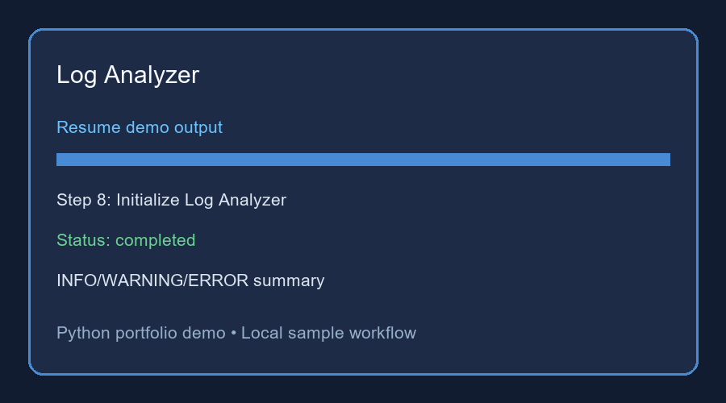
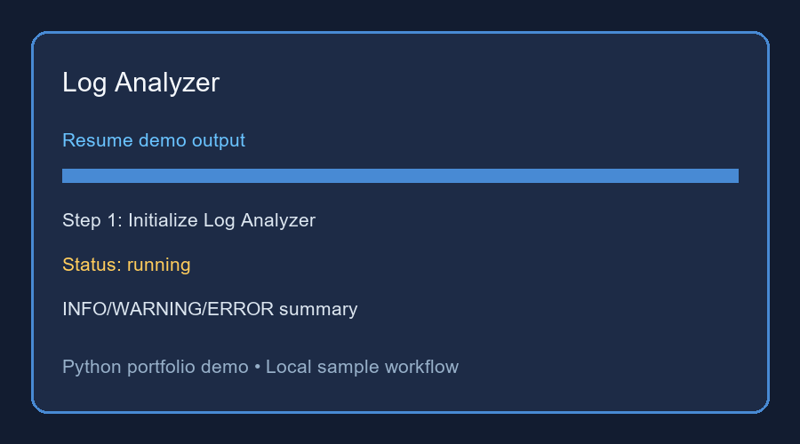

# Log File Analyzer

## Description
Parses structured logs to extract errors, warnings, and summary statistics for faster incident review.

## Real-World Scenario
Use this project to analyze server or application logs and generate a concise operations report.

## Features
- Parse log files line by line
- Extract errors and warnings
- Produce summary CSV and error report files

## Technologies Used
- Python 3
- csv
- datetime

## How to Run
```bash
python main.py --demo
```

## Sample Input
A log file with timestamps, severity levels, and event messages.

## Sample Output
A summary CSV and text file with extracted error entries.

## Screenshots




