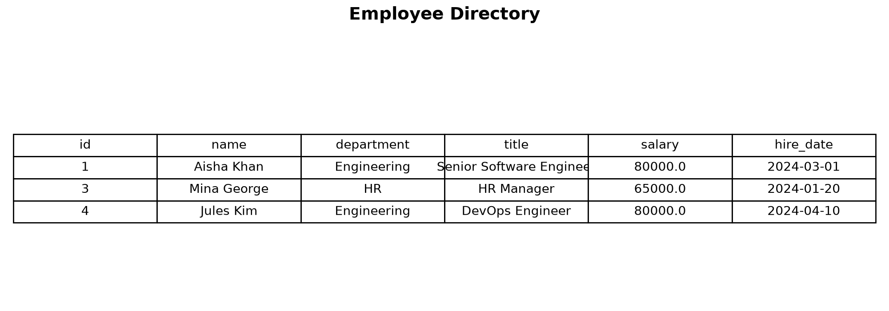

# Project 7 – Employee Management System

A freelance-ready employee management system with:

- CRUD operations using SQLite
- Search and filter employees
- Department summaries
- Excel report export

## Files

- `main.py` - employee management script
- `employees.db` - SQLite database created automatically
- `employee_report.xlsx` - generated employee report
- `README.md` - project documentation
- `screenshots/employee_list.png` - screenshot of employee list output

## What it does

- Creates and manages employee records
- Updates employee details
- Deletes employee records
- Searches employees by department, name, or title
- Exports employee data to Excel
- Generates department summary analytics

## Usage

1. Install dependencies:

```bash
pip install pandas openpyxl
```

2. Run the project:

```bash
python main.py
```

3. Open `employee_report.xlsx` to review exported employee data.

## Screenshots



## Notes

This project is designed for freelancing portfolios and can be extended with a web dashboard, full CLI menu, or REST API.
