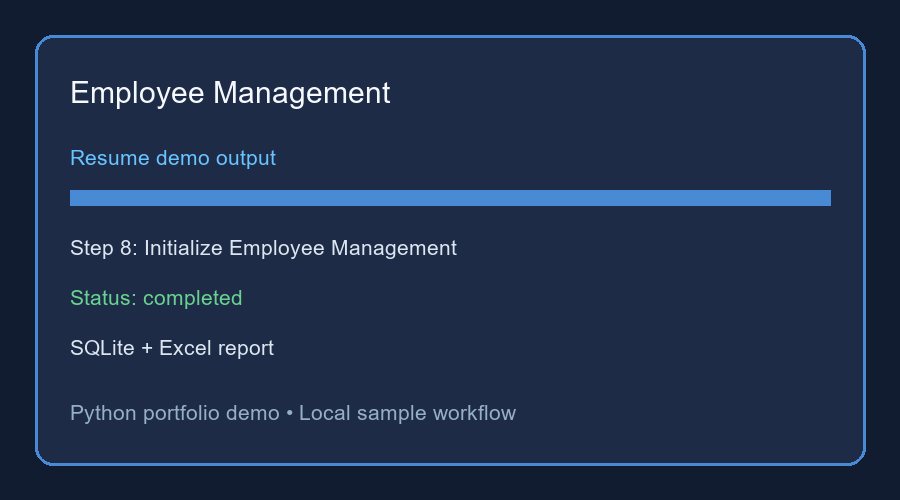
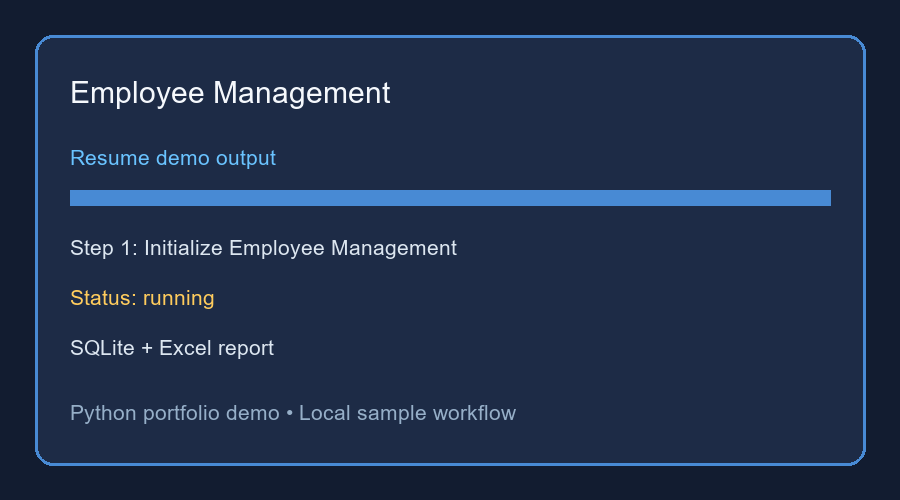

# Employee Management System

## Description
A simple SQLite-based employee tracker with reporting and export capabilities.

## Real-World Scenario
Use this system for small HR record keeping, employee tracking, and exportable reports.

## Features
- Add and edit employee records
- Generate Excel reports
- View employee lists and summaries

## Technologies Used
- Python 3
- sqlite3
- pandas
- openpyxl

## How to Run
```bash
python main.py --demo
```

## Sample Input
Employee name, role, department, and hire date details.

## Sample Output
An Excel report summarizing current employees.

## Screenshots




