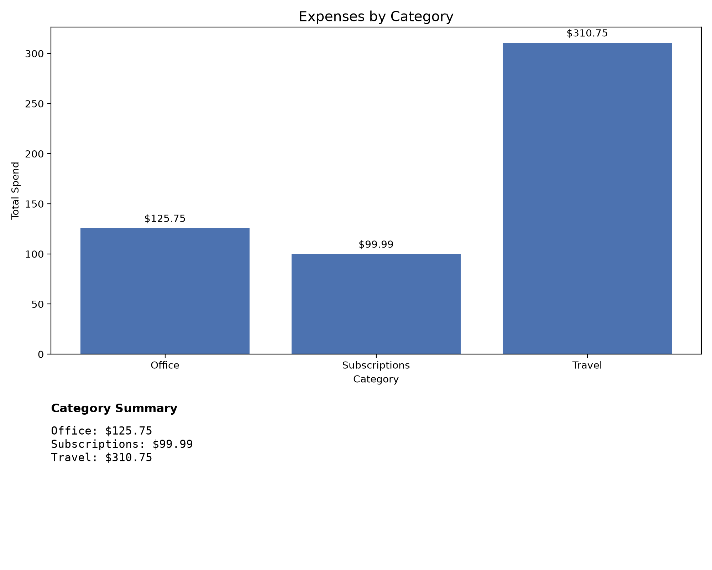

# Project 8 – Expense Tracker

A professional expense tracker project with real business value:

- Add/Edit/Delete expense transactions
- Monthly reports
- Category-wise spend analytics
- Excel export
- Chart generation

## Files

- `main.py` - expense tracker script
- `expenses.db` - SQLite database created automatically
- `expense_report.xlsx` - generated expense report
- `expense_category_chart.png` - category chart output
- `README.md` - project documentation
- `screenshots/expense_dashboard.png` - generated dashboard screenshot

## Features

- Add expense records
- Update and delete expenses
- Monthly reporting
- Category spend summary
- Export full report to Excel
- Generate category chart image

## Usage

1. Install dependencies:

```bash
pip install pandas openpyxl matplotlib
```

2. Run the project:

```bash
python main.py
```

3. Open `expense_report.xlsx` and `expense_category_chart.png` to review the output.

## Screenshots



## Notes

This project works well for small businesses and freelance bookkeeping tasks. You can extend it into a web or mobile reporting app.
