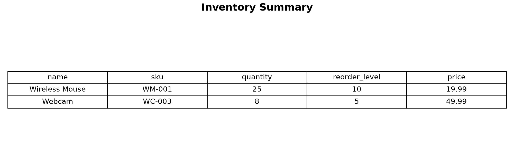

# Project 9 – Inventory Management System

A portfolio-ready inventory system for retail and operations workflows with:

- Product catalog management
- Stock updates
- Low-stock alerts
- Inventory value reports
- Excel export

## Files

- `main.py` - inventory system script
- `inventory.db` - SQLite database created automatically
- `inventory_report.xlsx` - generated inventory report
- `README.md` - project documentation
- `screenshots/inventory_summary.png` - generated screenshot

## Features

- Add new products
- Update stock quantities
- Delete products
- List all products
- Identify low-stock items
- Export inventory report to Excel

## Usage

1. Install dependencies:

```bash
pip install pandas openpyxl
```

2. Run the project:

```bash
python main.py
```

3. Open `inventory_report.xlsx` to review the generated inventory report.

## Screenshots



## Notes

This project is meant for small-business inventory operations and can be extended with a web dashboard, barcode scanner, or order module.
