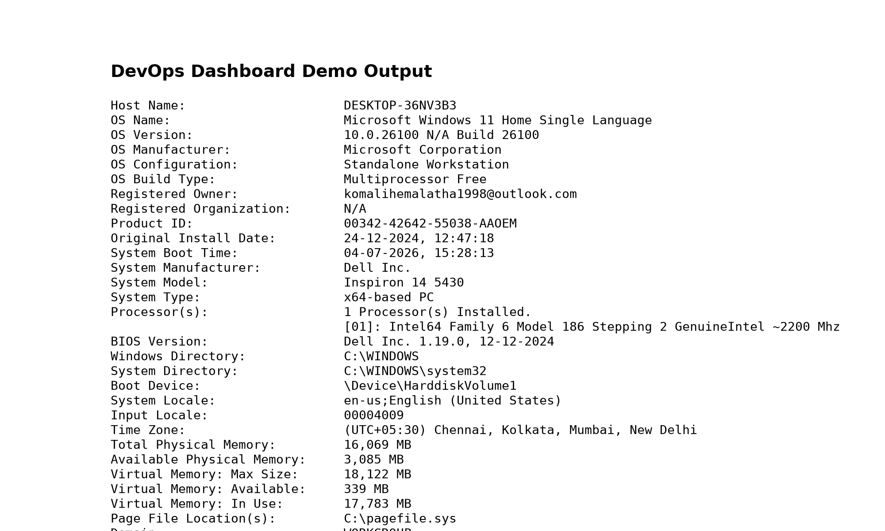

# Project 10 – DevOps Automation Dashboard

A portfolio-ready DevOps automation dashboard for cloud and infrastructure monitoring.

## Features

- Start/Stop EC2 instances
- List EC2 instances
- Create S3 buckets
- Upload files to S3
- Docker container status
- Kubernetes pod status
- System health checks
- Log analysis and alert reporting

## Files

- `main.py` - automation dashboard script
- `sample_logs.txt` - sample log file for analysis
- `alert_summary.txt` - generated log error summary
- `README.md` - project documentation
- `screenshots/dashboard_status.png` - generated output screenshot

## Requirements

- `boto3`
- AWS credentials configured
- Optional: Docker, kubectl installed for container/kubernetes checks

## Usage

1. Install dependencies:

```bash
pip install boto3
```

2. Run the demo:

```bash
python main.py --demo
```

## Screenshots



## Notes

This project is designed as a signature freelancing portfolio piece. It can be extended with a web dashboard, alert automation, and remediation workflows.
