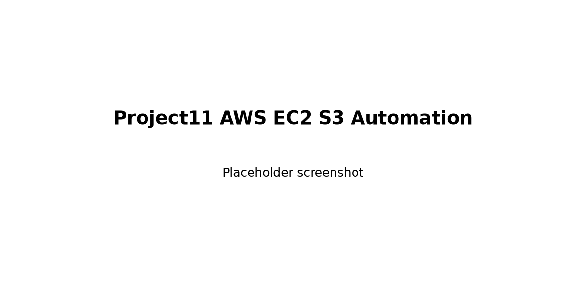

# AWS EC2 & S3 Automation

Lightweight automation scripts to list EC2 instances and manage S3 buckets (demo-friendly).

**Features**
- List EC2 instances (demo mode if no AWS creds).
- Create/list S3 buckets and upload files (demo fallback).

**Demo screenshot**: `screenshots/screenshot.png`
**Demo GIF**: `screenshots/demo.gif`

## Setup
1. Create a Python 3.8+ virtualenv and activate it.
2. Install dependencies:
```
pip install -r requirements.txt
```
3. (Optional) Configure AWS credentials with `aws configure` or set `AWS_ACCESS_KEY_ID` and `AWS_SECRET_ACCESS_KEY`.

## Run (demo)
```
python main.py --demo
```

Notes: Without AWS credentials the script runs in `--demo` mode and writes local sample outputs.
# Project 11 – AWS EC2 & S3 Automation

A focused automation script for EC2 and S3 tasks. Designed for portfolio/demo usage.

Features
- List EC2 instances
- Create an S3 bucket
- Upload a local file to S3

Files
- `main.py` - automation script (run with `--demo` for a safe demo)
- `requirements.txt` - Python dependencies
- `screenshots/` - placeholder screenshot folder

Requirements

Install dependencies:

```bash
pip install -r requirements.txt
```

Usage

```bash
python main.py --demo
```

## Screenshots



