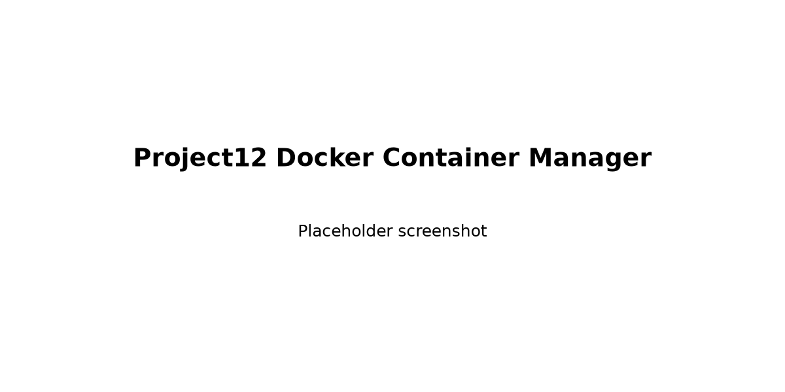

# Docker Container Manager

Simple wrappers around Docker CLI to list, run, and stop containers (demo-friendly).

**Features**
- List running containers
- Run a test container in demo mode
- Stop containers by name or ID

**Demo screenshot**: `screenshots/screenshot.png`
**Demo GIF**: `screenshots/demo.gif`

## Setup
1. Python 3.8+ recommended.
2. Install requirements:
```
pip install -r requirements.txt
```
3. Requires Docker installed locally to run real commands. Use `--demo` to run a safe local demo.

## Run (demo)
```
python main.py --demo
```
# Project 12 – Docker Container Manager

Small utility to inspect and manage Docker containers from the command line.

Files
- `main.py` - script that lists, starts, and stops containers (uses `docker` CLI)
- `requirements.txt` - empty (no Python deps required)
- `screenshots/` - placeholder screenshots

Usage

```bash
python main.py --demo
```

## Screenshots



