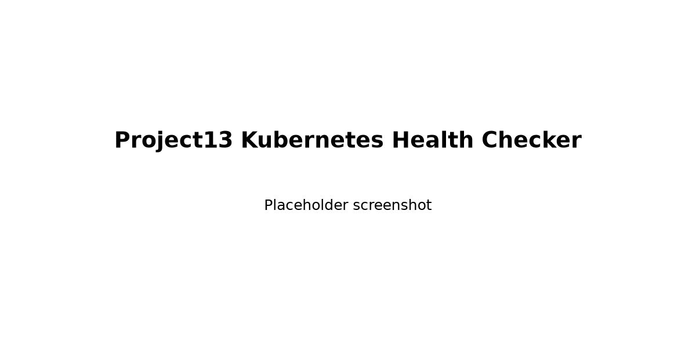

# Kubernetes Health Checker

Health-check utilities that wrap `kubectl` to report pod/node status and basic diagnostics.

**Features**
- Fetch pod status and health
- Summarize unhealthy pods

**Demo screenshot**: `screenshots/screenshot.png`
**Demo GIF**: `screenshots/demo.gif`

## Setup
1. Install `kubectl` and configure access to a cluster.
2. Install the Python requirements:
```
pip install -r requirements.txt
```

## Run (demo)
```
python main.py --demo
```
# Project 13 – Kubernetes Health Checker

Quick health-check tool that uses the `kubectl` CLI to inspect cluster nodes and pods.

Files
- `main.py` - run `kubectl get nodes` and `kubectl get pods --all-namespaces`
- `requirements.txt` - none (relies on `kubectl` binary)
- `screenshots/` - placeholder folder

Usage

```bash
python main.py --demo
```

## Screenshots



