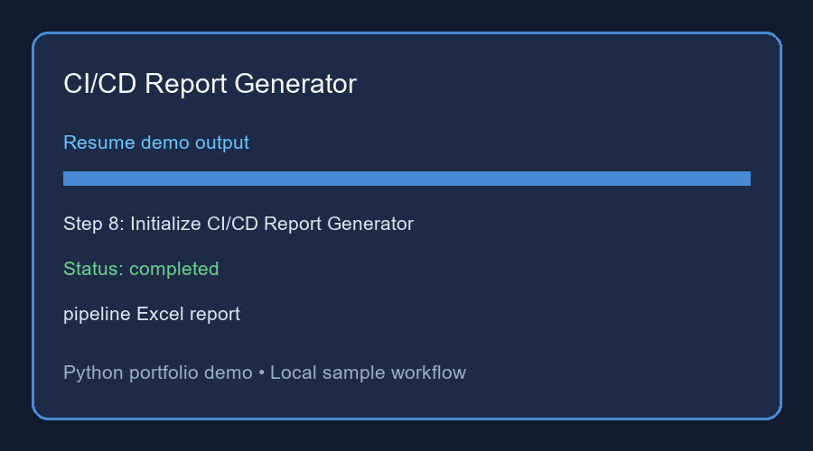
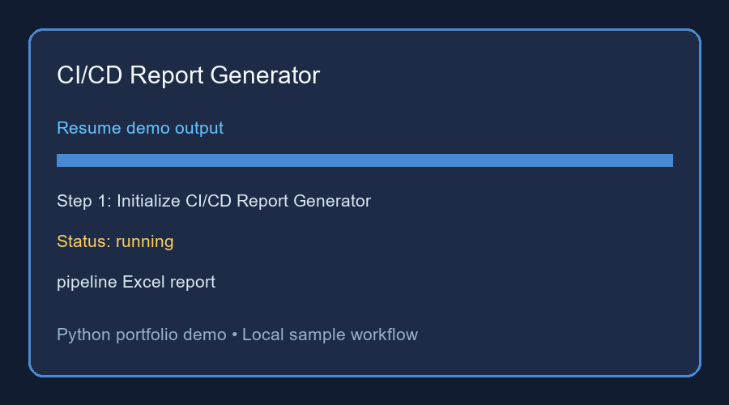

# CI/CD Pipeline Report Generator

## Description
Produces Excel reports from build and deployment pipeline data for stakeholder review.

## Real-World Scenario
Use this generator to turn pipeline metrics into a polished report for engineering leadership.

## Features
- Simulate pipeline run data
- Generate Excel summary reports
- Include pass/fail and duration metrics

## Technologies Used
- Python 3
- pandas
- openpyxl

## How to Run
```bash
python main.py --demo
```

## Sample Input
A list of pipeline stages with status and duration values.

## Sample Output
A CI/CD report workbook with aggregated metrics.

## Screenshots




