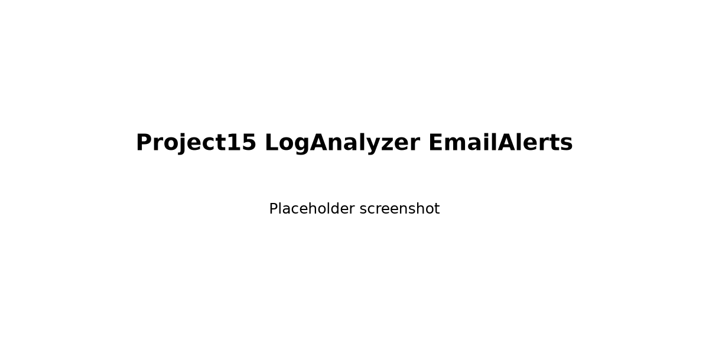

# Log Analyzer with Email Alerts

Parse logs, extract errors, and send email alerts (demo mode writes .eml files).

## Features
- Parse large log files and summarize errors
- Generate `.eml` alert files for review

## Setup
```
pip install -r requirements.txt
```

## Run (demo)
```
python main.py --demo
```

Demo screenshot: `screenshots/screenshot.png`
# Project 15 – Log Analyzer with Email Alerts

Parses application logs, extracts error entries, and creates an email alert (demo mode writes an .eml file).

Files
- `main.py` - demo script that writes `errors.txt` and `last_alert.eml`
- `requirements.txt` - none (uses Python standard library)
- `screenshots/` - placeholder folder

Usage

```bash
python main.py
```

## Screenshots



