# Python Portfolio Projects

A professional collection of 20 Python projects covering automation, analytics, DevOps, cloud computing, and real-time applications.

Each project includes:
- A runnable Python entry point
- A dedicated README
- Setup and dependency instructions
- Demo mode or sample workflow
- Screenshots and an animated demo GIF

## Automation & Business Applications

| Project | Description | Screenshot |
|---|---|---|
| [Project01 - File Organizer](Project01_FileOrganizer/) | Sort files into category folders | 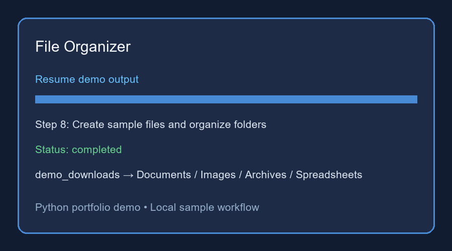 |
| [Project02 - Excel Automation](Project02_ExcelAutomation/) | Generate sales Excel reports | 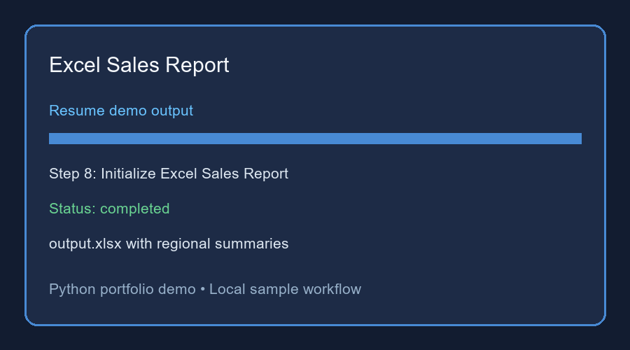 |
| [Project03 - Log File Analyzer](Project03_LogFileAnalyser/) | Analyze errors and warnings | 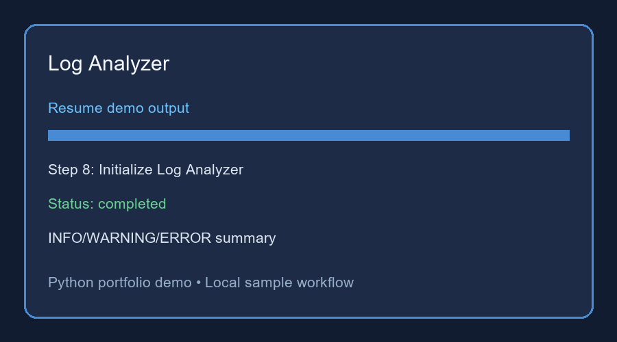 |
| [Project04 - PDF Toolkit](Project04_PDFToolkit/) | Merge, split, rotate, and extract PDFs | 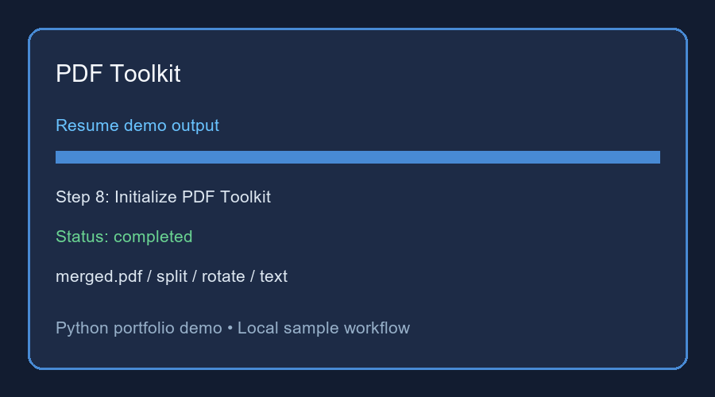 |
| [Project05 - Email Automation](Project05_EmailAutomation/) | Create automated email messages | 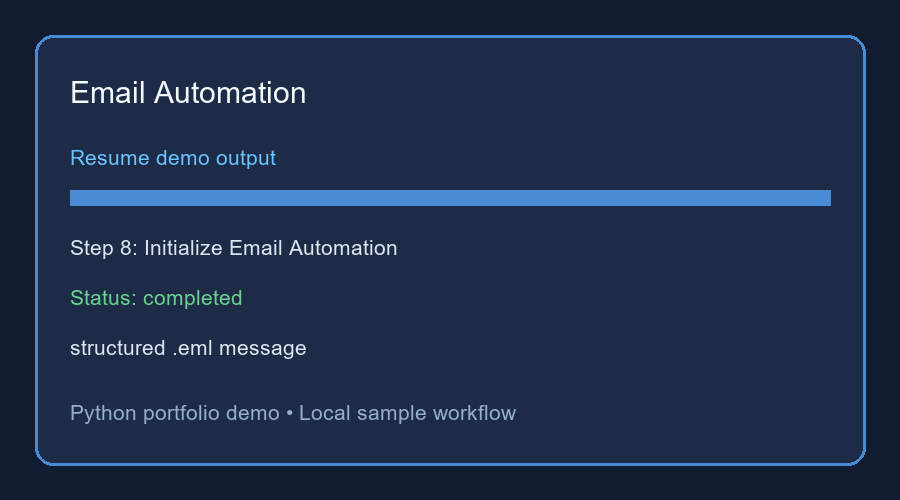 |
| [Project06 - AWS Automation](Project06_AWSAutomation/) | EC2 and S3 automation | 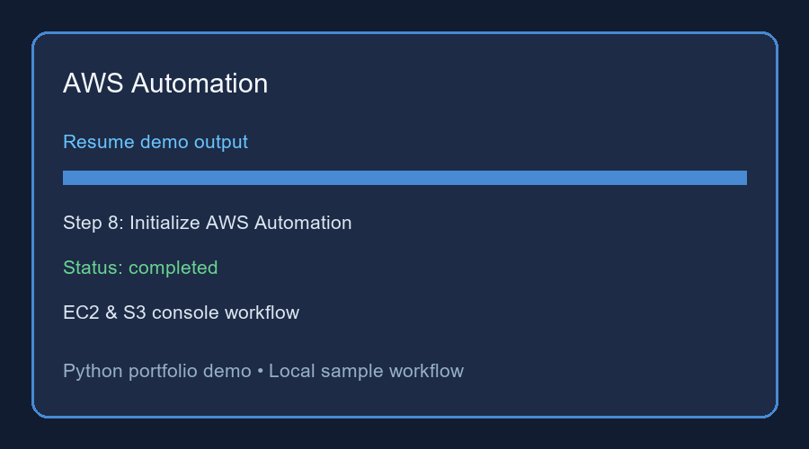 |

## Management Systems & Dashboards

| Project | Description | Screenshot |
|---|---|---|
| [Project07 - Employee Management](Project07_EmployeeManagementSystem/) | SQLite employee records and reports | 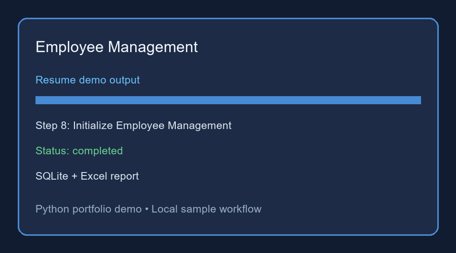 |
| [Project08 - Expense Tracker](Project08_ExpenseTracker/) | Track spending and category totals | 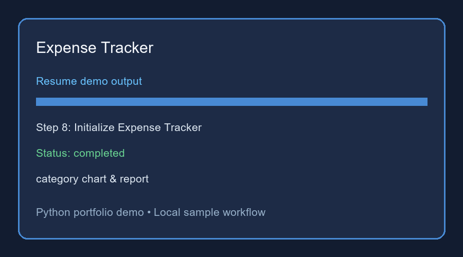 |
| [Project09 - Inventory Management](Project09_InventoryManagementSystem/) | Track inventory and low stock | 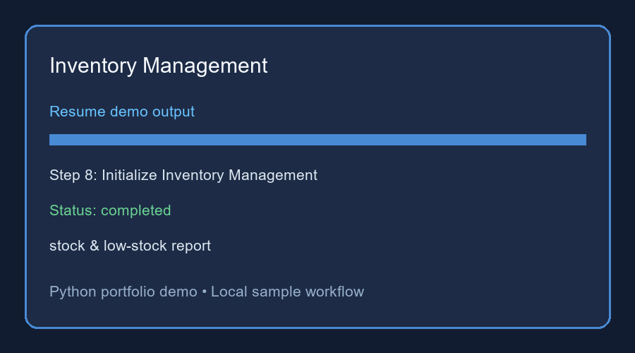 |
| [Project10 - DevOps Dashboard](Project10_DevOpsAutomationDashboard/) | AWS, Docker, Kubernetes, and logs | 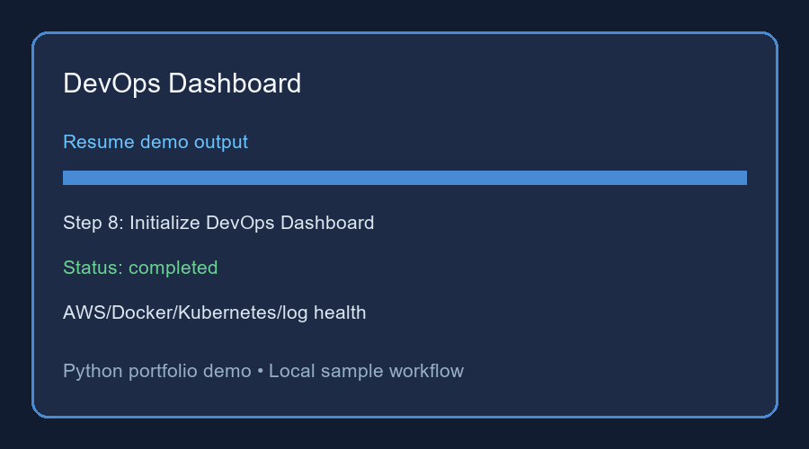 |

## Cloud, CI/CD & Operations

| Project | Description | Screenshot |
|---|---|---|
| [Project11 - AWS EC2/S3 Automation](Project11_AWS_EC2_S3_Automation/) | Cloud resource automation demo | 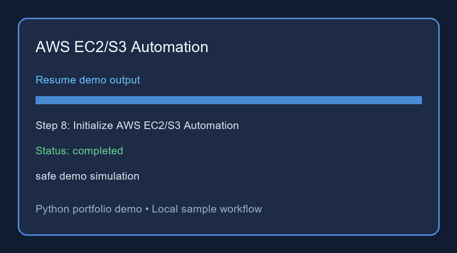 |
| [Project12 - Docker Container Manager](Project12_Docker_Container_Manager/) | Docker container management | 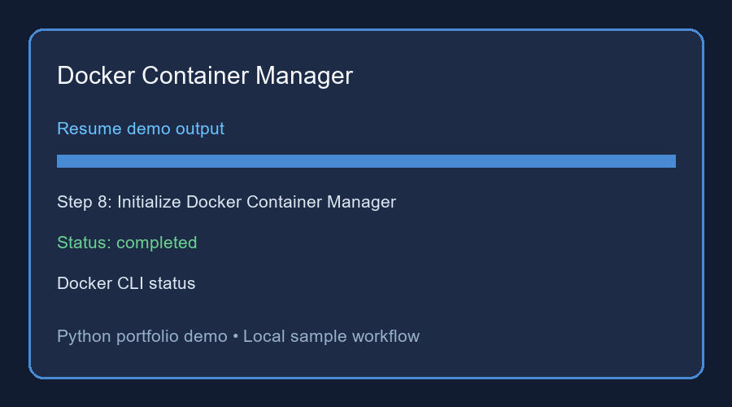 |
| [Project13 - Kubernetes Health Checker](Project13_Kubernetes_Health_Checker/) | Cluster and pod health checks | 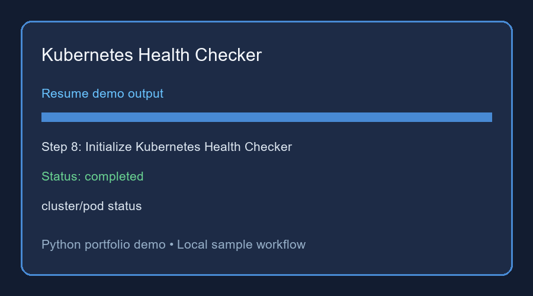 |
| [Project14 - CI/CD Report Generator](Project14_CICD_Pipeline_Report_Generator/) | Generate pipeline reports | 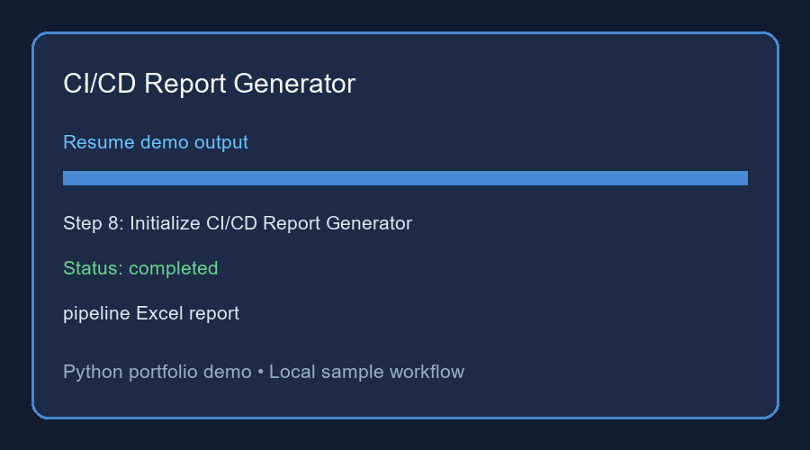 |
| [Project15 - Log Analyzer & Email Alerts](Project15_LogAnalyzer_EmailAlerts/) | Log alert and email workflow | 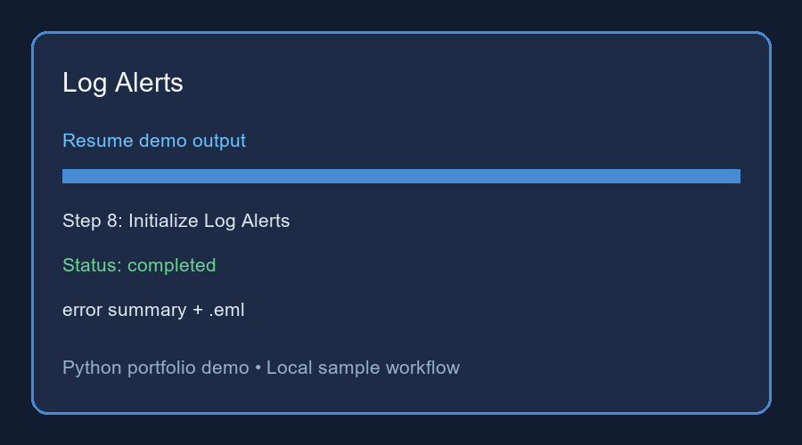 |

## Real-Time Projects

| Project | Description | Screenshot |
|---|---|---|
| [RT01 - WebSocket Chat](RT01_WebSocket_Chat_Server/) | Real-time chat broadcasting | 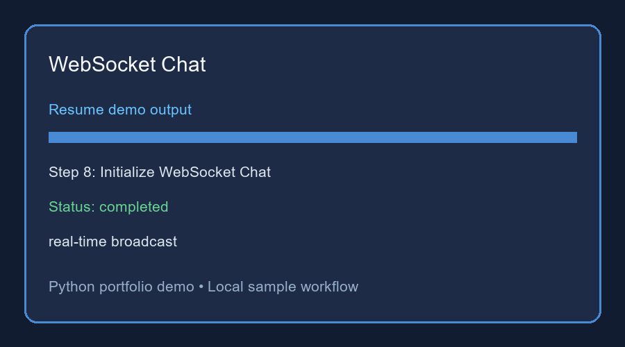 |
| [RT02 - Log Tailer Web UI](RT02_LogTailer_WebUI/) | Stream logs into a browser UI | 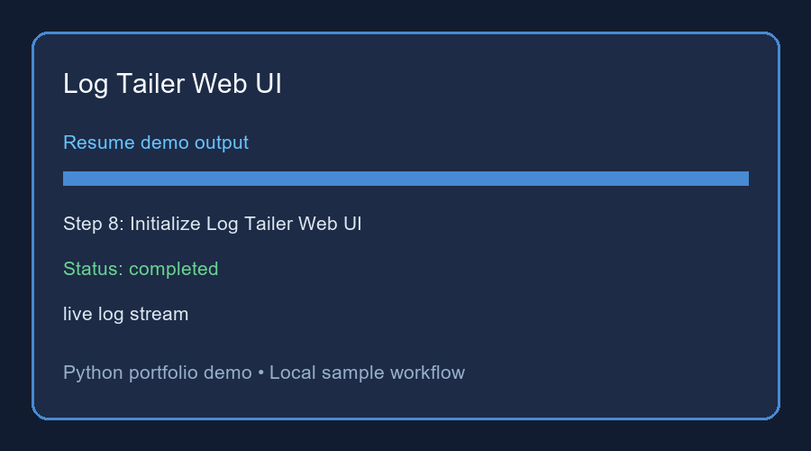 |
| [RT03 - MQTT Sensor Simulator](RT03_MQTT_Sensor_Simulator/) | Simulated IoT telemetry |  |
| [RT04 - File Watcher](RT04_FileWatcher_WS/) | WebSocket file-event notifications |  |
| [RT05 - System Metrics Streamer](RT05_System_Metrics_Streamer/) | Stream CPU and memory data | 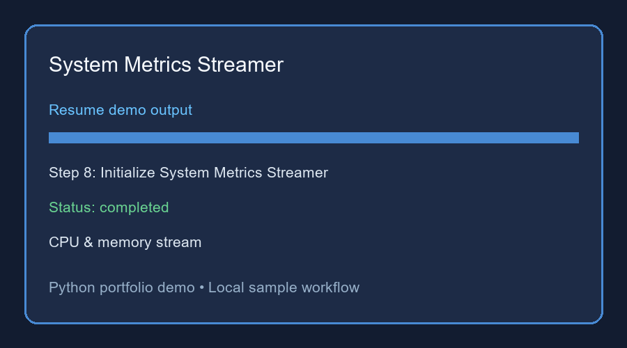 |

## Setup

```bash
python -m venv .venv
.venv\\Scripts\\activate
pip install -r <project-folder>/requirements.txt
python <project-folder>/main.py --demo
```
