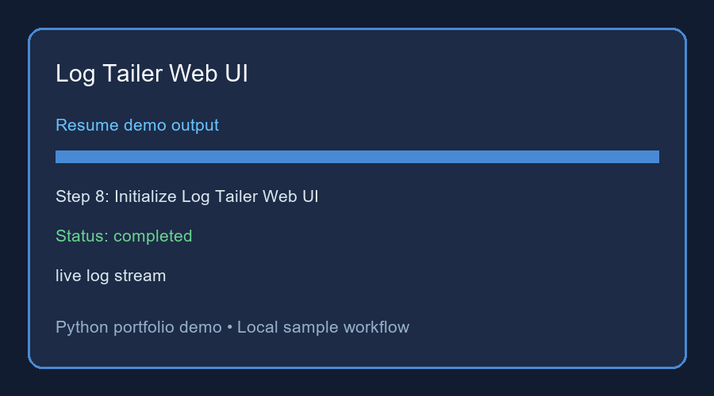
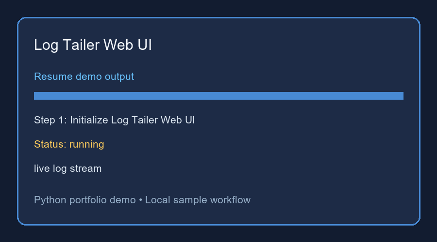

# Log Tailer Web UI

## Description
Streams log file updates to a browser-based dashboard in real time.

## Real-World Scenario
Use this project for live monitoring of application logs during deployments and debugging.

## Features
- Tail log files in real time
- Stream updates over WebSocket
- Serve a lightweight Web UI for display

## Technologies Used
- Python 3
- aiohttp
- asyncio
- websockets

## How to Run
```bash
python main.py --demo
```

## Sample Input
A log file path to watch and a browser session to view updates.

## Sample Output
Live log lines displayed in the browser UI.

## Screenshots




